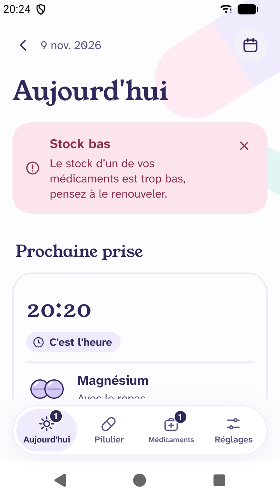
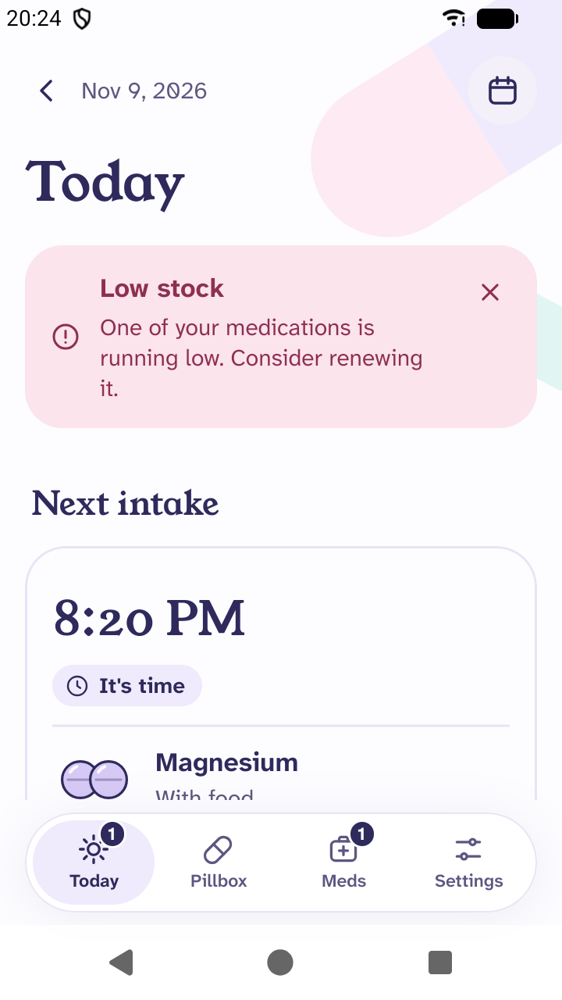
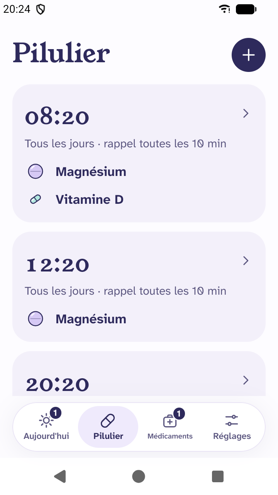
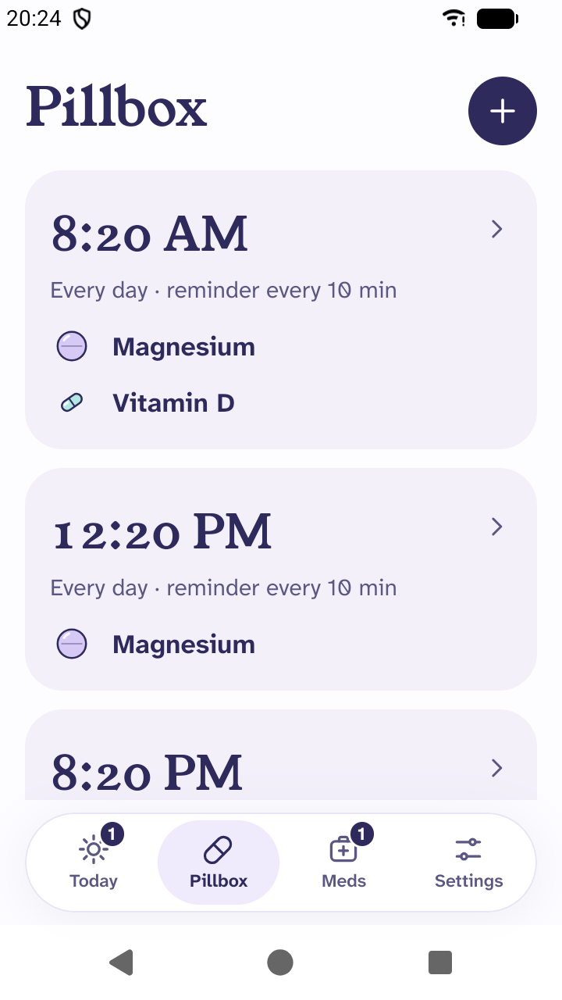
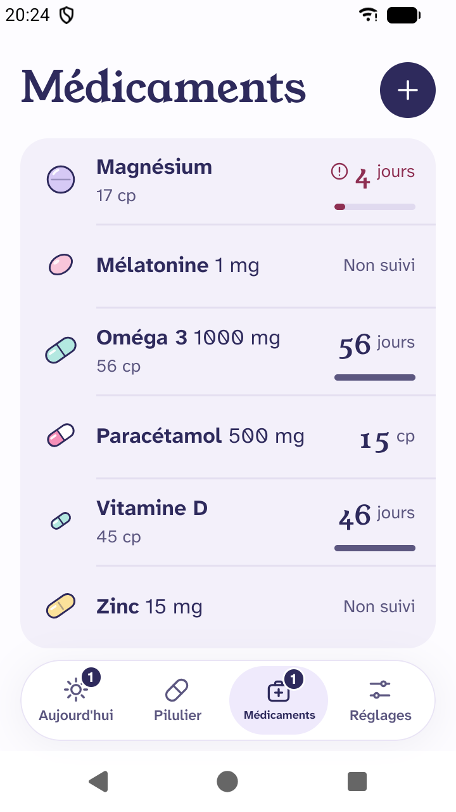
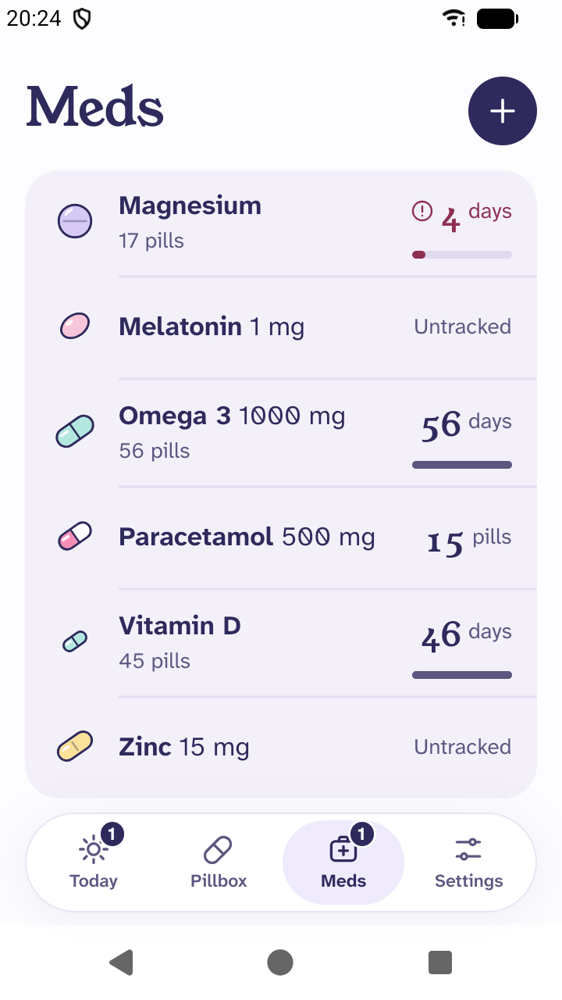
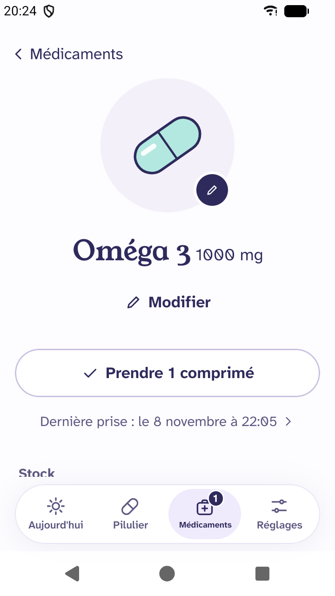
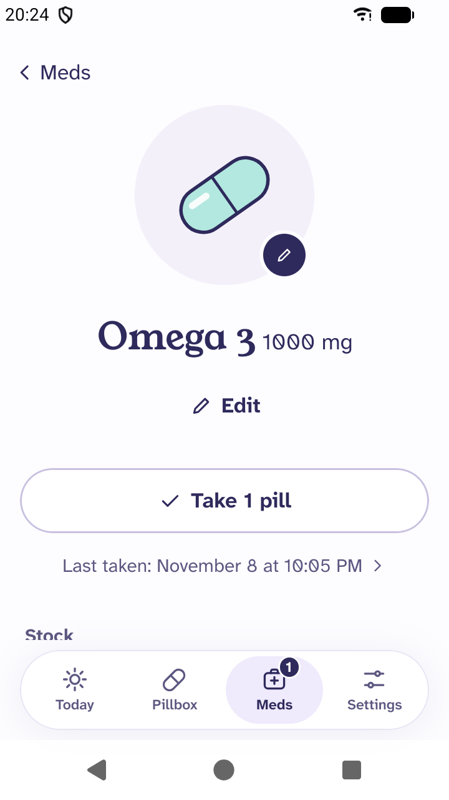
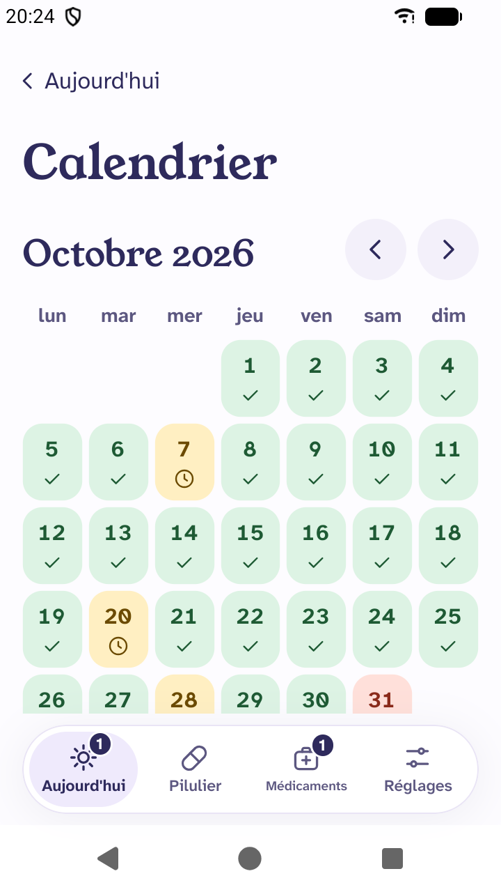
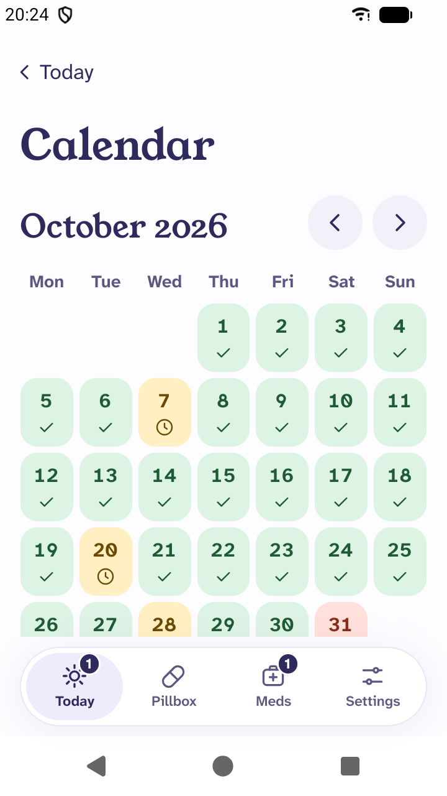

# Checklist Android : fiche Play Store, notes de version, site

Modifie les textes directement dans ce fichier, puis demande-moi de reporter les changements dans les fichiers sources.

## Récapitulatif

- [ ] Fiche Play Store : titre, description courte, description complète (FR, EN)
- [ ] Notes de version « À tester » (FR, EN)
- [ ] Visuels : icône 512, image de présentation 1024×500
- [ ] Captures d'écran (5 × FR, 5 × EN)
- [ ] Site : assistance, confidentialité, bêta (FR, EN)
- [ ] Points à trancher (en bas)

---

## 1. Fiche Play Store

Limites : titre 30 caractères, description courte 80, description complète 4000.

### Titre

[fr-FR/title.txt](fastlane/metadata/android/fr-FR/title.txt) · [en-US/title.txt](fastlane/metadata/android/en-US/title.txt)

```text
Pilbo
```

### Description courte

[fr-FR/short_description.txt](fastlane/metadata/android/fr-FR/short_description.txt) (75 car.)

```text
Pilbo est votre assistant qui vous aide à prendre vos médicaments.
```

[en-US/short_description.txt](fastlane/metadata/android/en-US/short_description.txt) (74 car.)

```text
A simple pill box: intake reminders, stocks and history, with no account.
```

### Description complète

[fr-FR/full_description.txt](fastlane/metadata/android/fr-FR/full_description.txt) (1005 car.)

```text
Pilbo est un pilulier virtuel conçu pour celles et ceux qui prennent beaucoup de médicaments et peuvent parfois oublier des prises. Pilbo est complètement gratuit, sans compte et vos données restent sur votre téléphone.

VOS PRISES DE MÉDUICAMENTS DANS VOTRE PILULIER
• Organisez vos prises à des heures différentes, chacune avec ses médicaments et ses quantités.
• Choississez les jours de la semaine de votre choix.
• Personalisez la forme, la taille et les couleurs de vos médicaments pour les identifier rapidement.

DES RAPPELS DISCRETS ET EFFICACES
• Une notification discrète toutes les 10 minutes au lieu d'une alarme que vous arrêtez sans prendre vos médicaments.
• Validez une prise directement depuis la notification ou dans l'application.
• Personnalisez le son de vos rappels.
• Retrouvez l'historique de vos prises dans un calendrier.

FINI LES BOITES VIDES
• Choisissez de suivre le stock de vos médicaments importants de votre pilulier.
• Chaque prise diminue automatiquement votre stock.
• Vous êtes alerté par une notification avant d'en manquer.
• Ajoutez en un clic une nouvelle boîte à votre stock.
• C'est aussi pour le stock de vos médicaments du quotidien (ex: Paracétamol).

CONFIDENTIALITÉ
• Pilbo est gratuit, sans publicité, sans récupération de vos données.
• Pas de compte, pas de serveur, vos données sont uniquement sur votre téléphone.
• Pilbo fonctionne sans connexion internet.
• Pilbo est un projet open-source : https://github.com/tentacode/pilbo

ACCESSIBILITÉ
• Pilbo a été conçu pour respecter les standards WCAG / RAAM.
• L'application supporte les technologies d'assistance : lecteurs d'écran, navigation au clavier…

Disponible en français et en anglais.

Pilbo n'est pas un dispositif médical. Il ne remplace pas l'avis d'un médecin ou d'un pharmacien.
```

[en-US/full_description.txt](fastlane/metadata/android/en-US/full_description.txt) (918 car.)

```text
Pilbo is a simple pill box on your phone. It reminds you of your medication intakes, tracks your stocks and keeps your history. No account needed: your data stays on your phone.

YOUR INTAKES
• Several intakes a day, each with its medications and quantities.
• On the days of the week you choose.
• As-needed medications, to take outside your intakes.

REMINDERS
• A notification at the time of each intake.
• Confirm an intake right from the notification.
• Choose the sound of your reminders.

STOCKS
• The stock goes down with each intake.
• An alert before you run out.

HISTORY
• A calendar of your intakes, day by day.

PRIVATE
• No account, no server.
• No advertising, no tracking.
• Pilbo works without an internet connection.

EASY TO READ
• Dark mode.
• Adapts to the text size of your phone.

In English and French.

Pilbo is not a medical device. It does not replace the advice of a doctor or pharmacist.
```

---

## 2. Notes de version « À tester »

Limite : 500 caractères. Copiées par `make android-beta` dans `changelogs/<versionCode>.txt`.

[what_to_test/fr-FR.txt](fastlane/what_to_test/fr-FR.txt) (234 car.)

```text
Merci de tester Pilbo !

Essayez d'ajouter vos prises, de valider un rappel depuis la notification et de suivre un stock. Si quelque chose vous semble étrange, écrivez-nous à pilbo@tentacode.dev, avec une capture d'écran si possible.
```

[what_to_test/en-US.txt](fastlane/what_to_test/en-US.txt) (208 car.)

```text
Thank you for testing Pilbo!

Try adding your intakes, taking one from a reminder notification and tracking a stock. If something feels off, write to us at pilbo@tentacode.dev, with a screenshot if possible.
```

---

## 3. Visuels

Identiques en FR et EN. Générés par `make artwork` (`scripts/generateArtwork.mjs`, réglages dans `assets/artwork/config.ts`).

### Icône 512 × 512

[en-US/images/icon.png](fastlane/metadata/android/en-US/images/icon.png)


### Image de présentation 1024 × 500

[en-US/images/featureGraphic.png](fastlane/metadata/android/en-US/images/featureGraphic.png)


---

## 4. Captures d'écran

Données anonymisées (compléments alimentaires), émulateur 720 × 1280.

|                | FR                                                                                               | EN                                                                                               |
| -------------- | ------------------------------------------------------------------------------------------------ | ------------------------------------------------------------------------------------------------ |
| 1. Aujourd'hui |     |     |
| 2. Pilulier    |   |   |
| 3. Médicaments |      |      |
| 4. Médicament  |       |       |
| 5. Calendrier  |  |  |

---

## 5. Site (GitHub Pages)

En ligne : https://tentacode.github.io/pilbo/. Pied de page commun à toutes les pages : liens Assistance / Confidentialité / Rejoindre la bêta, puis l'avertissement ci-dessous.

### Pied de page

[fr/index.html](website/fr/index.html) (et les autres pages FR)

```text
Pilbo n’est pas un dispositif médical. Elle ne remplace pas l’avis d’un médecin ou d’un pharmacien.
```

[index.html](website/index.html) (et les autres pages EN)

```text
Pilbo is not a medical device. It does not replace the advice of a doctor or pharmacist.
```

### Assistance

[fr/index.html](website/fr/index.html)

```text
Description (moteurs de recherche) : Pilbo est un pilulier simple pour iPhone et Android : rappels, stocks et historique, sans compte.

# Un pilulier simple dans votre téléphone

Pilbo vous rappelle vos prises de médicaments, suit vos stocks et garde votre historique. Sans compte : vos données restent sur votre téléphone.

Pour iPhone et Android, en français et en anglais.

## Ce que fait Pilbo

- Prises : plusieurs moments dans la journée, chacun avec ses médicaments et ses quantités, les jours de votre choix.
- Rappels : une notification à l’heure de chaque prise.
- Médicaments à la demande : à prendre en dehors des prises, si besoin.
- Stocks : le stock diminue à chaque prise, avec une alerte avant d’en manquer.
- Calendrier : l’historique de vos prises, jour par jour.
- Confidentialité : pas de compte, pas de serveur, tout reste sur votre téléphone.

## Besoin d’aide ?

Une question, un problème ou une idée ? Écrivez-nous à pilbo@tentacode.dev.

Pour nous aider à comprendre, essayez de décrire ce qui s’est passé, avec une capture d’écran si possible, et indiquez le modèle de votre téléphone.

## En savoir plus

- Politique de confidentialité
- Rejoindre la bêta Android
```

[index.html](website/index.html)

```text
Description (search engines): Pilbo is a simple pill box for iPhone and Android: reminders, stocks and history, with no account.

# A simple pill box on your phone

Pilbo reminds you of your medication intakes, tracks your stocks and keeps your history. No account needed: your data stays on your phone.

For iPhone and Android, in English and French.

## What Pilbo does

- Intakes: several times a day, each with its medications and quantities, on the days you choose.
- Reminders: a notification at the time of each intake.
- As-needed medications: to take outside your intakes, if needed.
- Stocks: the stock goes down with each intake, with an alert before you run out.
- Calendar: the history of your intakes, day by day.
- Private: no account, no server, everything stays on your phone.

## Need help?

A question, a problem or an idea? Write to us at pilbo@tentacode.dev.

To help us understand, try to describe what happened, with a screenshot if possible, and tell us your phone model.

## Learn more

- Privacy policy
- Join the Android beta
```

### Confidentialité

[fr/privacy/index.html](website/fr/privacy/index.html)

```text
Description (moteurs de recherche) : Pilbo ne collecte aucune donnée : tout ce que vous saisissez reste sur votre téléphone.

# Politique de confidentialité

Dernière mise à jour : 9 novembre 2026

Pilbo ne collecte aucune donnée. Tout ce que vous saisissez reste sur votre téléphone. Cette politique s’applique à Pilbo sur iPhone et sur Android.

## Aucune donnée collectée

Pilbo n’a ni compte ni serveur. Vos médicaments, vos prises, vos stocks et votre historique sont enregistrés uniquement sur votre téléphone. Nous ne les recevons jamais et ne pouvons pas les voir.

Pilbo fonctionne sans connexion internet.

## Pas de publicité, pas de suivi

Pilbo n’affiche aucune publicité, ne mesure pas votre utilisation de l’app et ne vous suit pas. Elle ne contient aucun service tiers qui collecte des données.

## Notifications

Les rappels sont programmés par Pilbo directement sur votre téléphone. Ils ne passent par aucun serveur.

## Sauvegardes

Pilbo n’envoie rien elle-même. Si la sauvegarde de votre téléphone est activée (iCloud ou Google), votre téléphone peut y inclure les données de Pilbo, comme pour vos autres apps. Ces sauvegardes sont gérées par Apple ou Google, dans votre compte. Nous n’y avons pas accès.

## Supprimer vos données

Désinstaller Pilbo supprime toutes ses données de votre téléphone.

## Modifications

Si cette politique change, nous mettrons à jour cette page et sa date, en haut.

## Contact

Une question sur cette politique ? Écrivez-nous à pilbo@tentacode.dev.
```

[privacy/index.html](website/privacy/index.html)

```text
Description (search engines): Pilbo collects no data: everything you enter stays on your phone.

# Privacy policy

Last updated: November 9, 2026

Pilbo collects no data. Everything you enter stays on your phone. This policy applies to Pilbo on iPhone and Android.

## No data collected

Pilbo has no account and no server. Your medications, intakes, stocks and history are only stored on your phone. We never receive them, and we cannot see them.

Pilbo works without an internet connection.

## No advertising, no tracking

Pilbo shows no advertising, does not measure your use of the app and does not track you. It contains no third-party service that collects data.

## Notifications

Reminders are scheduled by Pilbo directly on your phone. They do not go through any server.

## Backups

Pilbo sends nothing by itself. If backup is turned on on your phone (iCloud or Google), your phone may include Pilbo’s data in it, as for your other apps. These backups are handled by Apple or Google, in your account. We have no access to them.

## Deleting your data

Uninstalling Pilbo deletes all its data from your phone.

## Changes

If this policy changes, we will update this page and its date at the top.

## Contact

A question about this policy? Write to us at pilbo@tentacode.dev.
```

### Rejoindre la bêta

[fr/beta/index.html](website/fr/beta/index.html)

```text
Description (moteurs de recherche) : Rejoignez la bêta de Pilbo sur Android : deux étapes, puis installez Pilbo depuis le Play Store.

# Rejoindre la bêta de Pilbo

Merci de nous aider à tester Pilbo ! La bêta est ouverte sur Android. Pour la rejoindre, deux étapes, dans cet ordre.

Utilisez pour les deux étapes le même compte Google que le Play Store de votre téléphone.

1. Rejoindre le groupe des testeurs
   Rejoignez le groupe Google des testeurs de Pilbo. Il vous donne accès au test.
   [Bouton] Rejoindre le groupe des testeurs → https://groups.google.com/g/pilbo-testeurs

2. S’inscrire au test
   Touchez ensuite « Devenir testeur », puis installez Pilbo depuis le Play Store. Les mises à jour arrivent automatiquement.
   [Bouton] S’inscrire au test → https://play.google.com/apps/testing/com.tentacode.pilbo

Pilbo peut mettre quelques minutes à apparaître dans le Play Store après votre inscription.

## Donner votre avis

Quelque chose vous semble étrange, ou vous avez une idée ? Écrivez-nous à pilbo@tentacode.dev, avec une capture d’écran si possible.
```

[beta/index.html](website/beta/index.html)

```text
Description (search engines): Join the Pilbo beta on Android: two steps, then install Pilbo from the Play Store.

# Join the Pilbo beta

Thank you for helping us test Pilbo! The beta is open on Android. Joining takes two steps, in this order.

Use the same Google account as the Play Store on your phone for both steps.

1. Join the testers group
   Join the Google group of Pilbo testers. It gives you access to the test.
   [Button] Join the testers group → https://groups.google.com/g/pilbo-testeurs

2. Sign up for the test
   Then tap “Become a tester” and install Pilbo from the Play Store. Updates arrive automatically.
   [Button] Sign up for the test → https://play.google.com/apps/testing/com.tentacode.pilbo

Pilbo may take a few minutes to show up in the Play Store after you sign up.

## Share your feedback

Something feels off, or you have an idea? Write to us at pilbo@tentacode.dev, with a screenshot if possible.
```

---

## Points à trancher

- [ ] **Genre de « Pilbo » en français** : le site dit « Pilbo n’envoie rien **elle**-même », « **Elle** ne remplace pas… » (l’app), la fiche Play Store dit « **Il** vous rappelle… », « **Il** ne remplace pas… » (le pilulier). Choisir un seul genre partout.
- [ ] **Apostrophes** : la fiche Play Store et les notes de version utilisent l’apostrophe droite (`'`), le site l’apostrophe typographique (`’`). Harmoniser ou non.
