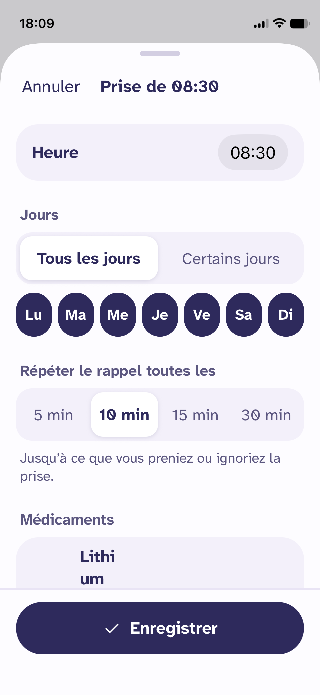
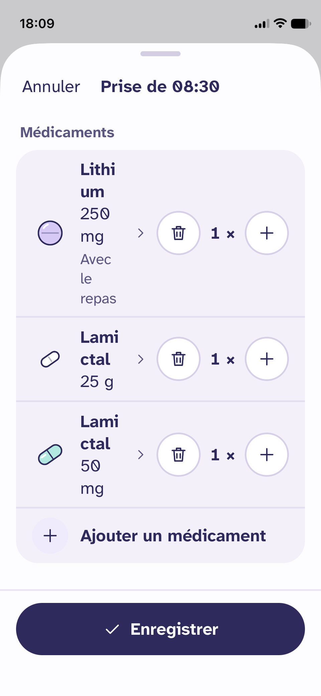
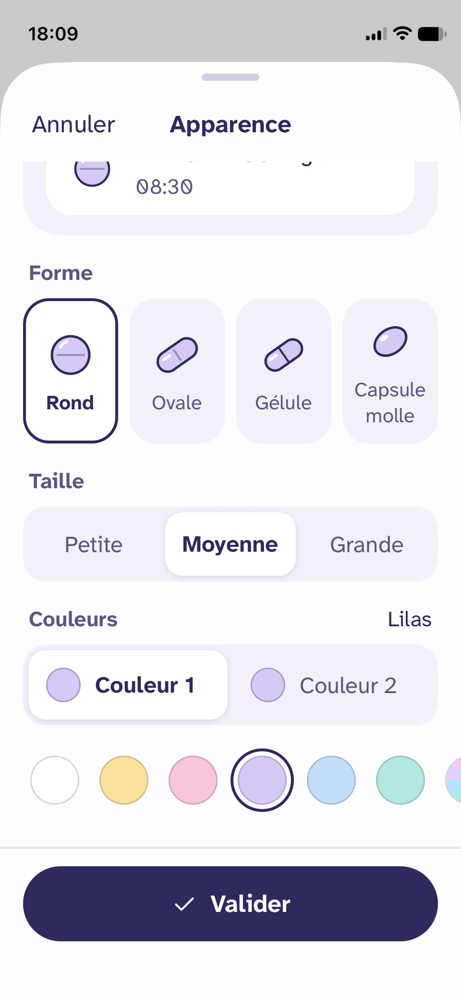

# Responsive and tweaks

J'ai un tout petit iPhone (iPhone 12 mini), du coup certains design "cassent". J'en profite aussi pour ajouter quelques tweaks rapides à implémenter.

**IMPORTANT : chaque étape doit être visellement testée par moi sur mon téléphone**

## Design qui cassent sur un petit téléphone

### Les jours sur l'écran de création / modification d'une prise

Les jours rentrent dans l'écran, mais ils ne sont plus ronds mais ovales.

Suggestion : si l'écran ne permet pas de tout afficher sans déformation, passer samedi et dimanche à la ligne, et tout centrer horizontallement

### La liste de médicaments sur l'écran de création / modification d'une prise

Le nom, le dosage et le détail du médicament sont tout tassés à cause de la place que prennent les boutons de quantité.

Suggestion : passer les boutons en dessous de la pillule, et du nom du médicament complet si l'écran est trop petit. Les boutons seront centrés horizontallement.

### Le color picker dans l'apparence de la pillule

Le choix du color-picker est presque invisible, seul un bout sort à droite, il est très dur à cliquer.

Suggestion : en mobile laisser les couleurs en haut, et mettre un bouton en bas pour choisir la couleur, idéalement pas un simple bouton mais un truc un peu sympa, si ça marche bien on pourrait même faire la même disposition sur des téléphones plus grands.

## Tweaks

### Background "pillules" sur l'écran "Aujourd'hui"

Le fond pastel avec plusieurs pillules qui est en haut de l'écran "Aujourd'hui" devrait toujours être en haut et suivre le scroll. Si le résultat n'est pas satisfaisant, on reviendra en arrière.

## Décisions

### Général

- Chaque partie (jours, médicaments, couleur, fond) se termine par un arrêt : vérification visuelle sur le téléphone.
- Jours et médicaments partagent la même logique de mesure de largeur (`onLayout`).

### Jours

- Ronds de taille fixe (≥ 44 pt), qui grandissent avec le Dynamic Type.
- Mesure de la largeur disponible : si les 7 jours ne tiennent pas, disposition forcée 5 + 2 (Lu → Ve, puis Sa Di), centrée.

### Liste de médicaments

- Mesure de la largeur de la ligne : si la place restante pour le texte passe sous un seuil (token), le stepper passe sous la pilule et le nom, centré.

### Color picker

- Les 6 couleurs restent en haut. La pastille « Autre couleur » est remplacée par un bouton sous les couleurs, sur tous les téléphones.
- Design non tranché : à l'implémentation, 2 ou 3 variantes sont proposées, testées sur le téléphone, une seule est gardée (les autres sont supprimées).

### Fond « pilules » sur « Aujourd'hui »

- Le fond reste fixe en haut de l'écran, derrière le contenu qui défile par-dessus. Le titre défile normalement.
